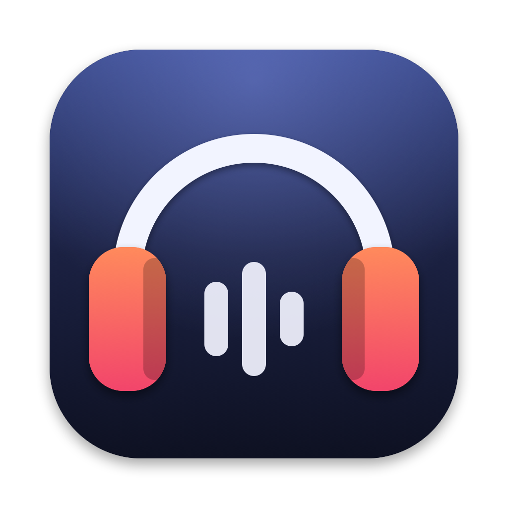

# Cans

A small native macOS menu bar app for Bose headphones: battery, listening
modes or noise cancelling, equalizer and a few settings, without the phone app.

> **Unofficial.** Not affiliated with, endorsed by, or supported by Bose Corporation.
> "Bose" and "QuietComfort" are trademarks of Bose Corporation, used here only to
> describe compatibility.

## Features

- Battery percentage in the menu bar, red at 20% or below
- Low battery notifications at 20% and 10%
- Several pairs at once: each connected pair gets its own state and alerts; pick one in the popover header
- Play the Mac's audio on a chosen pair (switches the default output, like the Sound menu)
- Switch listening modes: Quiet, Aware, Immersion and your custom modes
  (QC Ultra), or the noise cancelling level (QC35 II)
- QC Ultra: create, edit and delete custom modes (name, noise cancelling strength, wind block,
  immersive audio), pick the modes the headphones' button cycles through, and whether they
  turn on in the last mode used
- QC Ultra: immersive audio off, still or motion
- Switch to a chosen mode while the Mac is on a call, and back afterwards
- See paired devices and switch the headphones between them; on a QC Ultra, also which
  device is playing, the track's title, and a link to move audio to the other connected device
- "This Mac Only": disconnect the headphones' other devices in one click, and reconnect them later
- 3-band equalizer (treble / mid / bass, −10…+10) with built-in and your own named presets
- Toggle auto-pause on removal, auto-answer calls and multipoint
- Choose what the Action button (QC35 II) or the Shortcut button's long press (QC Ultra) does,
  from the actions the headphones report
- Self voice (sidetone) and auto-off timer
- QC Ultra, in the gear menu: rename the headphones, voice prompts (on/off, language, battery
  announcement), pairing mode, turn off; firmware and serial number
- Optional voice announcement on mode change
- Reconnects automatically: on Bluetooth connect, on wake, and with backoff
- Launch at login
- Scriptable from the command line, `cans://` URLs and the Shortcuts app

## Supported headphones

| Model | Product ID | Firmware | Status |
|---|---|---|---|
| QuietComfort Ultra Headphones (1st gen) | `0x4066` | 1.6.7 | Tested |
| QuietComfort 35 II | `0x4020` | 4.8.1 | Reading tested; changing settings untested |

Other Bose devices that speak BMAP get a basic profile (battery, name, paired
devices) and will likely work, but haven't been tested. See
[Adding a model](#adding-a-model).

## Install

**Homebrew**

```sh
brew install --cask egno/tap/cans
```

**Manual:** download `Cans-<version>.dmg` or `.zip` from
[Releases](https://github.com/egno/cans/releases) and move `Cans.app` to
`/Applications`.

Cans isn't signed with an Apple Developer ID, so on first launch macOS will say
it can't verify the developer. Open **System Settings → Privacy & Security**,
scroll down and click **Open Anyway**, or run:

```sh
xattr -dr com.apple.quarantine /Applications/Cans.app
```

The Homebrew cask does this for you. Pair your headphones with the Mac in
System Settings first; on first launch macOS asks for Bluetooth permission.

Requires macOS 14 or later, on Apple Silicon or Intel.

## Build from source

Requires Xcode 16 or later (Swift 6).

```sh
./scripts/bundle.sh          # builds build/Cans.app (release, ad-hoc signed)
open build/Cans.app
```

On first launch macOS asks for Bluetooth permission.

For development:

```sh
swift test                   # protocol unit tests
swift run Cans            # runs unbundled; uses your terminal's Bluetooth permission
```

Logs:

```sh
/usr/bin/log stream --predicate 'subsystem == "io.github.egno.cans"' --info
```

## Scripting

The app's binary is also a command line tool: given a command, it passes it to the
running Cans and prints the answer. Link it somewhere on your `PATH` once:

```sh
ln -s /Applications/Cans.app/Contents/MacOS/Cans /usr/local/bin/cans
```

```sh
cans status                      # every connected pair: battery, mode, equalizer, devices
cans status --json               # also firmware, serial number, immersive audio, favourite
                                 # modes, what's playing and from which device, where reported
cans mode Aware                  # a listening mode, or a noise cancelling level (off, low, high)
cans eq Bass boost               # an equalizer preset; `cans presets` lists them
cans this-mac-only               # drop the other devices; again to bring them back (or on / off)
cans disconnect iPhone           # one of the headphones' paired devices
cans connect iPhone
cans immersive still             # immersive audio: off, still or motion (QC Ultra)
cans power-off                   # turn the headphones off (QC Ultra)
cans mode Quiet --headset Atom   # another pair than the one the popover shows, by name or address
```

Names match without case, and a unique beginning is enough. The exit status is 0 when
the headphones did it, 1 with the reason on stderr when they didn't, 69 when Cans isn't running.

The same commands work as URLs, which don't report back; a failure shows in the popover:

```sh
open "cans://mode/Quiet"
open "cans://eq/Bass%20boost?headset=Atom"
open "cans://this-mac-only/toggle"
```

In the **Shortcuts** app use *Run Shell Script* with the commands above (its output can
feed the next action), or *Open URLs* with a `cans://` URL. Cans has no Shortcuts actions
of its own: those need metadata that only an Xcode build generates.

A call is the Mac's microphone being in use by any app. Pick the mode for calls under
**Controls**; it applies when the headphones are the Mac's output or its microphone, and
the previous mode comes back after the call unless you changed it meanwhile.

## How it works

Bose's apps control headphones with an undocumented protocol called **BMAP**.
It runs over a classic Bluetooth serial channel (the RFCOMM channel of the
Serial Port service, UUID `0x1101`: channel 2 on QC Ultra, 8 on QC35 II),
alongside the normal audio connection. Cans finds the channel through SDP and
falls back to the channels its profiles know. Each packet is:

```
[function block, function, operator, payload length, payload...]
```

Cans opens only that control channel, never the audio link, so connecting or
quitting never interrupts playback.

| Package | Purpose |
|---|---|
| `Sources/BMAP` | Packet framing, payload decoders, request builders, and a request/response client. No Bluetooth code, fully unit-tested. |
| `Sources/BMAP/Profiles` | One `ModelProfile` per model: product IDs, fallback channel, supported features, noise control style. |
| `Sources/Cans` | IOBluetooth RFCOMM transport, `HeadphonesManager` (discovery, one `HeadphoneSession` per connected pair), SwiftUI `MenuBarExtra` UI, and the features on top: call mode, This Mac Only, equalizer presets, scripting. |
| `Tests/BMAPTests` | Tests using bytes captured from real headphones. |
| `Tests/CansTests` | Session tests against a fake device. |

### Protocol notes (QC Ultra gen 1)

| Address | Operation | Meaning |
|---|---|---|
| `2.2` | GET | Battery `[percent, …]` |
| `1.7` | GET / SETGET `[value, band]` | EQ, `[min, max, value, band]` per band |
| `31.3` | GET / START `[index, announce]` | Current mode (`ff` = unknown until set this session) |
| `31.6` | GET `[index]` | Mode slot config: name at offset 6 (32 bytes), slots 0–9 |
| `1.24`, `1.27` | GET / SETGET `[0/1]` | Auto-pause, auto-answer |
| `1.9` | GET / SETGET `[0x80, 9, action]` | Shortcut button long press `[button, event, action, supported mask (4 bytes)]` |
| `31.6` | SETGET (39 bytes) | Create or change a custom mode: `[index, prompt (2), name (32), level, auto, immersive, wind block]` |
| `31.9` | START `[index]` | Reset a custom slot (deletes the mode) |
| `31.5`, `31.8` | GET / SETGET | Remember last mode `[0/1]`; favourite modes `[count, bitmask…]` |
| `5.15` | GET / SETGET `[0/1/2]` | Immersive audio: off, still, motion |
| `5.1`, `5.6` | GET; START (listing) | Audio source `[mask (2), type, MAC]`; now playing, one record per attribute |
| `1.2`, `1.3` | SETGET | Name (bare UTF-8, 31 bytes); voice prompts `[flags, battery announcement]` |
| `0.7` | GET | Serial number |
| `7.4`, `4.8`, `4.12` | START | Power off, pairing mode, move audio to a connected device |

Not every write above has been tried on a 1st-gen QC Ultra: immersive audio and favourites
haven't, and power off, pairing mode and audio routing are known only from the 2nd gen.
Cans shows the headphones' answer in the popover if they refuse.

The `1.9` supported mask is a big-endian bitset over action numbers (bit 0 in the
last byte); other models may add a 4-byte mask of currently unavailable actions.
Writes echo the button and event the device reported.

Reading the full mode list (`31.1`) requires authentication on this model, so
slots are read one by one instead.

### Protocol notes (QC35 II)

| Address | Operation | Meaning |
|---|---|---|
| `1.6` | GET / SETGET `[level]` | Noise cancelling `[level, supported mask]`: 0 off, 1 high, 3 low |
| `1.11` | GET / SETGET `[1, level]` | Self voice `[1, level, supported mask]` |
| `1.9` | GET / SETGET `[0x10, 4, action]` | Action button `[button, event, action, supported mask (1 byte)]` |
| `1.4` | GET / SETGET `[minutes]` | Auto-off: 0, 5, 20, 40, 60 or 180 |
| `1.3` | GET | Voice prompts: bit 5 on, low 5 bits language |

EQ (`1.7`) gets no reply at all, so it must never be requested; there are no
fblock 31 modes and no model name (`0.15`).

## Adding a model

1. Read its product ID (`0.3`; Cans logs it) and find its BMAP channel.
2. Add `Sources/BMAP/Profiles/<Model>.swift` with a `ModelProfile`: product IDs,
   fallback channel, the `Feature`s it answers, and its noise control style
   (`.modes` or `.ancLevels`). List only features the device answers: some
   models time out instead of returning an error.
3. Add it to `ModelRegistry.all` and add decode tests with captured payloads.

The app shows each section only when the profile supports its feature, so no
UI changes are needed unless the model brings a new kind of setting.

## Credits

Protocol knowledge comes from community reverse-engineering work, especially
[bosectl](https://github.com/aaronsb/bosectl) (MIT) and
[based-connect](https://github.com/Denton-L/based-connect).

## License

[MIT](LICENSE)
